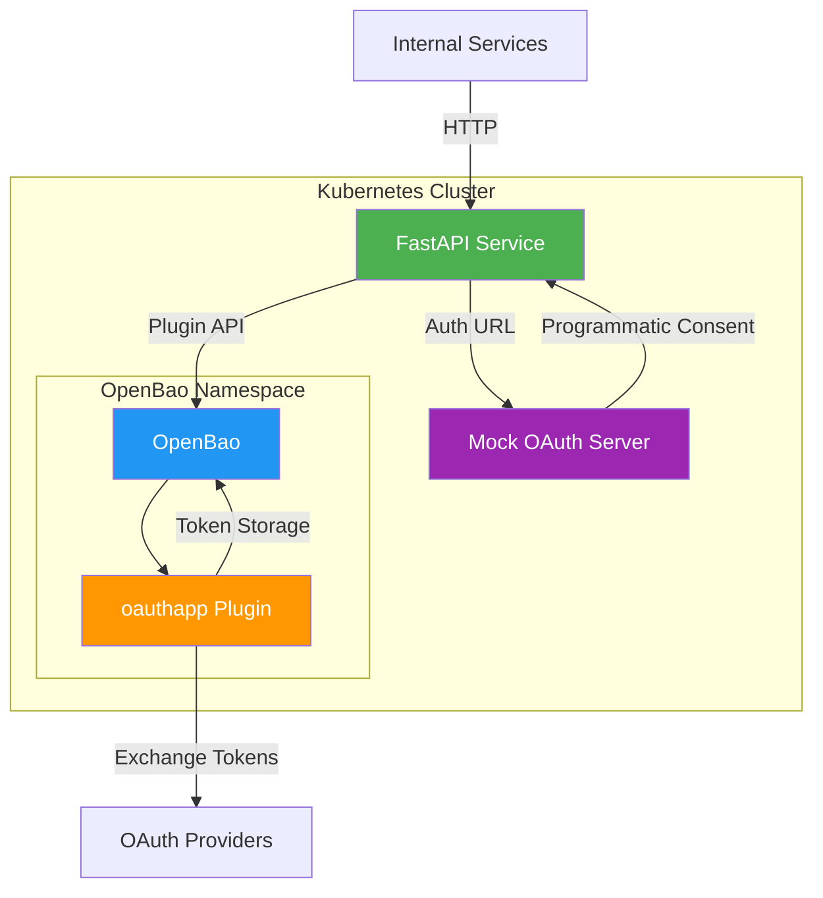
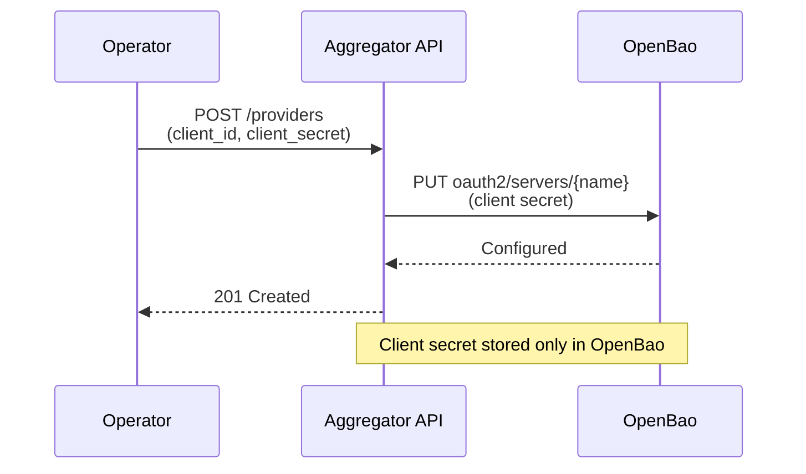
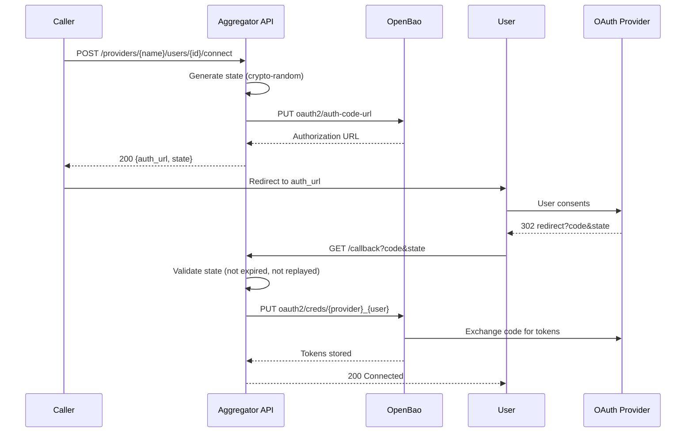
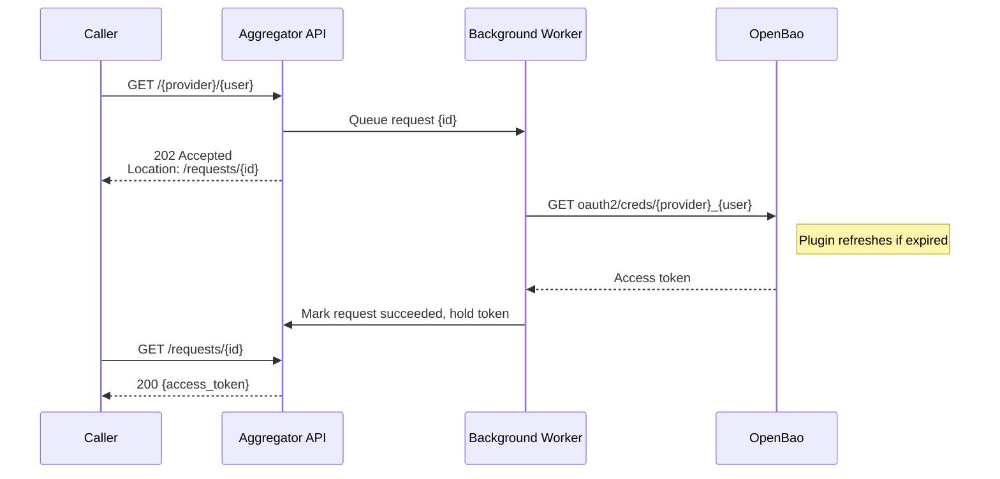

# Integration Aggregator

A production-ready OAuth token orchestration service that provides a unified API for managing OAuth provider registrations, user consent flows, and access token retrieval. Built with Python FastAPI and backed by OpenBao's oauthapp plugin, the service delegates all OAuth logic and token storage to OpenBao, ensuring secrets never touch application memory or logs.

This service solves the common problem of duplicated OAuth implementations across product teams by providing a centralized, secure token management layer that integrates with multiple OAuth providers (GitHub, Google, GitLab, and generic OIDC).

---

## Project Overview

The Integration Aggregator acts as an orchestration layer between internal services and OAuth providers. It handles:

- **Provider Registration**: Securely registers OAuth providers with client credentials
- **Consent Flow**: Manages OAuth authorization-code flows with cryptographically secure state validation
- **Token Retrieval**: Provides asynchronous access tokens with automatic refresh handled by OpenBao
- **Secrets Management**: Integrates with OpenBao for least-privilege access to OAuth secrets

### Key Design Philosophy

The service implements no OAuth logic itself. All token storage, refresh, and authorization-code exchanges are delegated to OpenBao's oauthapp plugin. This separation of concerns ensures:

- Zero knowledge of tokens in the application layer
- Centralized secret management with least-privilege policies
- Automatic token refresh before expiry
- Consistent security posture across all providers

**Upstream Attribution**: This project builds upon the oauthapp plugin architecture from [OpenBao](https://openbao.org) and [openbao-plugin-secrets-oauthapp](https://github.com/openbao/openbao-plugin-secrets-oauthapp).

---

## Architecture

### System Components



### Request Flow

The service implements three core flows:

#### 1. Provider Registration


#### 2. User Consent Flow


#### 3. Async Token Retrieval


### Data Placement

| Data Type | Location | Rationale |
|-----------|----------|-----------|
| Client secrets | OpenBao (`oauth2/servers/{name}`) | Persistent secrets store, never exposed to application |
| OAuth access/refresh tokens | OpenBao (`oauth2/creds/{provider}_{user}`) | Plugin handles refresh and expiry, never in application memory |
| Provider metadata (name, client_id, scopes) | Service memory (ProviderRegistry) | Fast lookup, no secrets, acceptable to lose on restart |
| OAuth state values | Service memory (OAuthStateStore) | CSRF protection, consume-once validation, short-lived (10 min TTL) |
| Async request records | Service memory (RequestManager) | Polling interface, tokens held transiently, TTL cleanup (1 hour) |

**Note**: In-memory state limits deployment to a single replica. Horizontal scaling would require distributed storage (Redis or similar). See [DESIGN.md](DESIGN.md) for production improvements.

---

## Technology Stack

### Core Application
- **Python 3.11+**: Runtime environment
- **FastAPI 0.115.6**: Async web framework with automatic OpenAPI documentation
- **Uvicorn 0.34.0**: ASGI server with async support
- **Pydantic 2.7.1**: Data validation and settings management
- **httpx 0.28.1**: Async HTTP client for OpenBao communication

### Infrastructure
- **Kubernetes**: Container orchestration with minikube for local development
- **Helm 3.16.1**: Package management for application deployment
- **Docker**: Containerization with multi-stage builds
- **OpenBao 2.7.1**: Secrets management with oauthapp plugin v3.4.1

### Testing & CI
- **pytest 8.3.4**: Unit and integration testing
- **pytest-asyncio 0.25.2**: Async test support
- **Ruff 0.8.6**: Fast Python linter and formatter
- **k6 0.54.0**: Performance testing
- **GitHub Actions**: CI/CD pipeline with minikube integration

### Mock OAuth Provider
- **navikt/mock-oauth2-server 6.1.3**: Programmatically drivable OIDC provider for CI smoke tests

---

## Key Features

### Security
- **Zero token knowledge**: Application never stores or logs OAuth tokens
- **Least-privilege OpenBao policy**: Service token limited to `oauth2/*` paths only
- **Cryptographic state validation**: URL-safe random tokens with TTL and consume-once semantics
- **Secret redaction**: Logger automatically redacts tokens, secrets, and codes from all output
- **Read-only root filesystem**: Docker container runs with non-root user and immutable filesystem
- **Security context**: Kubernetes pods run as non-root with dropped capabilities

### Asynchronous Processing
- **Non-blocking token retrieval**: `GET /{provider}/{user}` returns `202 Accepted` immediately
- **Background worker**: Separate asyncio task processes token requests without blocking the API
- **Polling interface**: Clients poll `GET /requests/{id}` for completion status
- **Request state management**: In-memory request records with TTL-based cleanup
- **Terminal state idempotency**: Multiple calls to mark succeeded/failed are safe

### OAuth Provider Support
- **GitHub**: Full OAuth 2.0 authorization-code flow
- **Google**: OAuth 2.0 web server flow
- **GitLab**: OAuth 2.0 authorization-code flow
- **Generic OIDC**: Configurable issuer URL for any OIDC-compliant provider
- **Mock OAuth**: navikt/mock-oauth2-server for automated CI testing

### Observability
- **Structured logging**: JSON-formatted logs with configurable log levels
- **Health endpoints**: `/healthz` (liveness) and `/readyz` (readiness with OpenBao dependency check)
- **Kubernetes probes**: Liveness and readiness probes configured with appropriate thresholds
- **Performance reporting**: k6 generates latency and throughput metrics uploaded as CI artifacts

---

## API Endpoints

### Provider Management

#### Register a Provider
```http
POST /providers
Content-Type: application/json

{
  "name": "github",
  "provider": "github",
  "client_id": "abc123",
  "client_secret": "secret456",
  "scopes": ["read:user", "repo"]
}

Response: 201 Created
{
  "name": "github",
  "provider": "github",
  "client_id": "abc123",
  "scopes": ["read:user", "repo"]
}
```

**Note**: Client secret is stored in OpenBao and never returned in responses.

### OAuth Flow

#### Start Connection
```http
POST /providers/{provider}/users/{user}/connect

Response: 200 OK
{
  "authorization_url": "https://github.com/login/oauth/authorize?...",
  "state": "abc123xyz"
}
```

#### OAuth Callback
```http
GET /callback?code=xyz789&state=abc123xyz

Response: 200 OK
{
  "status": "connected"
}
```

### Token Retrieval

#### Request Token (Async)
```http
GET /{provider}/{user}

Response: 202 Accepted
Location: /requests/{request_id}

{
  "request_id": "req_abc123",
  "status": "pending"
}
```

#### Poll Request Status
```http
GET /requests/{request_id}

Response: 200 OK (when succeeded)
{
  "request_id": "req_abc123",
  "status": "succeeded",
  "access_token": "gho_...",
  "token_type": "bearer",
  "expires_in": 7200
}
```

**Note**: Token is only returned when status is `succeeded`. Failed requests return error details.

### Health Checks

#### Liveness
```http
GET /healthz

Response: 200 OK
{
  "status": "ok"
}
```

#### Readiness
```http
GET /readyz

Response: 200 OK
{
  "status": "ready",
  "openbao": "up"
}
```

Returns `503 Service Unavailable` if OpenBao is unreachable.

---

## Quick Start

### Prerequisites

- **minikube** (v1.30+): Local Kubernetes cluster
- **kubectl**: Kubernetes CLI
- **Helm 3.16+**: Package manager
- **Docker**: Container runtime
- **Python 3.11+**: For local development (optional)

### Local Deployment

```bash
# Clone the repository
git clone <repository-url>
cd integration-aggregator-takehome

# Deploy the full stack (OpenBao, oauthapp plugin, aggregator, mock OAuth)
make up

# Port-forward to access the service locally
kubectl port-forward -n aggregator svc/aggregator 8000:80

# Run the smoke test to verify the OAuth flow
make smoke

# Tear down the application (preserves OpenBao)
make down
```

The `make up` command is idempotent—it can be run multiple times safely and will only create resources that don't exist.

### Manual Testing

```bash
# Register a mock OIDC provider
curl -X POST http://localhost:8000/providers \
  -H "Content-Type: application/json" \
  -d '{
    "name": "test-oidc",
    "provider": "oidc",
    "client_id": "test-client",
    "client_secret": "test-secret",
    "scopes": ["openid", "profile"],
    "provider_options": {
      "issuer_url": "http://mock-oauth.aggregator.svc.cluster.local:8080/default"
    }
  }'

# Start OAuth connection
curl -X POST http://localhost:8000/providers/test-oidc/users/test-user/connect

# Request token (async)
curl http://localhost:8000/test-oidc/test-user
# Returns: 202 with Location header

# Poll for completion
curl http://localhost:8000/requests/{request_id}
# Returns: 200 with access_token when succeeded
```

---

## Deployment

### Production Deployment

The Helm chart is published to GitHub Container Registry (GHCR) via CI. To deploy from the published chart:

```bash
# Log in to GHCR
helm registry login ghcr.io --username <username> --password <token>

# Pull and install the chart
helm pull oci://ghcr.io/<username>/integration-aggregator --version <version>
helm install aggregator ./integration-aggregator-<version>.tgz \
  --namespace aggregator \
  --create-namespace \
  --set openbao.address=https://openbao.example.com:8200 \
  --set openbao.existingSecret=aggregator-openbao \
  --set redirectUrl=https://aggregator.example.com/callback
```

### Configuration

Key Helm values:

```yaml
# Application configuration
app:
  port: 8000
  logLevel: INFO
  httpTimeoutSeconds: 5.0
  oauthStateTtlSeconds: 600  # 10 minutes
  requestTtlSeconds: 3600     # 1 hour

# OpenBao integration
openbao:
  address: http://openbao.openbao.svc.cluster.local:8200
  mount: oauth2
  existingSecret: aggregator-openbao  # Kubernetes Secret with OPENBAO_TOKEN

# OAuth callback URL
redirectUrl: http://localhost:8000/callback

# Resource limits
resources:
  limits:
    cpu: 500m
    memory: 512Mi
  requests:
    cpu: 100m
    memory: 128Mi

# Security context
securityContext:
  allowPrivilegeEscalation: false
  readOnlyRootFilesystem: true
  capabilities:
    drop:
      - ALL
```

See [charts/aggregator/values.yaml](charts/aggregator/values.yaml) for all configuration options.

### OpenBao Policy

The service requires a least-privilege OpenBao policy:

```hcl
path "oauth2/servers/*" {
  capabilities = ["create", "update", "read", "list"]
}

path "oauth2/auth-code-url" {
  capabilities = ["update"]
}

path "oauth2/creds/*" {
  capabilities = ["create", "update", "read"]
}
```

This policy grants access only to the oauthapp plugin paths required for the service to function.

---

## Testing

### Unit Tests

```bash
# Run all unit tests
make test

# Run with coverage
pytest tests/ --cov=app --cov-report=html
```

Unit tests cover:
- Individual service logic (ProviderRegistry, OAuthStateStore, RequestManager)
- OpenBao adapter with fake implementation
- Error handling and edge cases
- Configuration validation

### Integration Tests

```bash
# Run smoke test (requires deployed environment)
make smoke
```

The smoke test executes the full OAuth flow:
1. Registers a mock OIDC provider
2. Initiates OAuth connection
3. Completes callback programmatically with mock OAuth server
4. Submits async token request
5. Polls for successful completion

### Linting

```bash
# Run Ruff linter
make lint

# Auto-fix issues
ruff check app tests --fix
```

### Performance Testing

```bash
# Run k6 performance test
k6 run perf/token_retrieval.js --out json=perf-results.json

# Generate report
python3 -c "from app.performance_report import generate_report; generate_report('perf-results.json', 'perf-report.md')"
```

Performance metrics (from CI runs):
- **Average latency**: 1.35 ms
- **p50 latency**: 1.08 ms
- **p95 latency**: 2.33 ms
- **Throughput**: 30.25 requests/second
- **Failure rate**: 0.00%

See [perf/REPORT.md](perf/REPORT.md) for detailed results.

---

## CI/CD Pipeline

The GitHub Actions workflow (`.github/workflows/ci.yml`) runs on every push to `main`/`master`:

1. **Lint and Test**
   - Install Python 3.11
   - Run Ruff linter
   - Execute pytest unit tests

2. **Build and Push**
   - Build Docker image with BuildKit
   - Push to GHCR with branch and SHA tags
   - Package and push Helm chart to GHCR as OCI artifact

3. **Integration Test**
   - Set up minikube with Docker driver
   - Install OpenBao with oauthapp plugin v3.4.1
   - Register plugin with SHA-256 verification
   - Deploy mock OAuth server
   - Deploy aggregator service
   - Run smoke test
   - Execute k6 performance test
   - Upload performance report as artifact

The CI pipeline ensures green builds on the default branch before any deployment.

---

## Engineering Decisions

### Async Request Pattern

**Decision**: Token retrieval returns `202 Accepted` with a polling endpoint instead of blocking on OpenBao.

**Rationale**:
- Prevents API threads from blocking on downstream latency
- Allows horizontal scaling of API workers independent of token retrieval
- Provides clear separation between request submission and fulfillment
- Matches HTTP semantics for long-running operations

**Trade-off**: Adds client-side polling complexity. Future improvement could use Server-Sent Events or WebSockets.

### In-Memory State

**Decision**: OAuth state and async request records stored in process memory.

**Rationale**:
- Simplicity for single-replica deployment
- No external dependencies (Redis, database)
- Fast access without network latency
- Acceptable for current use case (single replica)

**Trade-off**: Limits horizontal scaling. State is lost on replica restart. Production deployment would require distributed storage (Redis or similar). Documented in [DESIGN.md](DESIGN.md).

### OpenBao Dev Mode

**Decision**: Current deployment uses OpenBao dev mode for simplicity.

**Rationale**:
- No unsealing process required
- No persistence setup needed
- No TLS configuration for local development
- Root token available for initial setup

**Trade-off**: Dev mode skips persistence, unsealing, TLS, and HA. Production deployment requires OpenBao in production mode with Raft storage and proper unsealing. Documented in [DESIGN.md](DESIGN.md).

### Token Redaction

**Decision**: Logger redacts tokens, secrets, and codes via regex pattern matching.

**Rationale**:
- Defense-in-depth against accidental logging
- Catches sensitive data in debug output
- No manual redaction needed in code
- Centralized security policy

**Trade-off**: Regex-based approach may have false positives/negatives. Structured logging with field-level redaction would be more robust but adds complexity.

### Least-Privilege Policy

**Decision**: OpenBao policy grants access only to `oauth2/*` paths with specific capabilities.

**Rationale**:
- Principle of least privilege
- Prevents accidental access to other secrets
- Clear audit boundary
- Aligns with security best practices

**Trade-off**: Requires manual policy creation. Terraform-based OpenBao configuration would automate this (noted as production improvement).

---

## Current Limitations

1. **Single-replica deployment**: In-memory state prevents horizontal scaling
2. **OpenBao dev mode**: No persistence, TLS, unsealing, or HA
3. **No retry logic**: Transient OpenBao failures cause request failures
4. **No rate limiting**: API is vulnerable to abuse
5. **No circuit breaking**: Cascading failures possible
6. **Limited observability**: Structured logging only, no metrics or tracing
7. **No PKCE**: OAuth flows rely on state parameter only (PKCE would add security)
8. **No token revocation**: No mechanism to revoke compromised tokens

See [DESIGN.md](DESIGN.md) for prioritized production improvements.

---

## Future Improvements

### High Priority

1. **Distributed storage**: Replace in-memory state with Redis for horizontal scaling
2. **Message queue architecture**: Use RabbitMQ/Kafka for reliable async token retrieval with retries
3. **Production OpenBao**: Deploy with Raft storage, TLS, unsealing, and HA
4. **Observability**: Add Prometheus metrics and distributed tracing
5. **Resilience**: Implement exponential backoff retries and circuit breaking

### Medium Priority

6. **Rate limiting**: Add per-IP and per-user rate limits
7. **PKCE support**: Enhance OAuth security with proof key for code exchange
8. **Token revocation**: Add endpoint to revoke compromised tokens
9. **Administrative tooling**: Health checks, configuration validation, state cleanup
10. **Terraform integration**: Manage OpenBao configuration with Terraform

### Low Priority

11. **Webhook notifications**: Notify callers when async requests complete
12. **Token metadata**: Store additional metadata (scopes, expiry) with tokens
13. **Multi-region support**: Geographic distribution with region-aware token storage
14. **Provider health monitoring**: Track provider availability and deprecate failing providers

---

## Documentation

- [DESIGN.md](DESIGN.md): Architecture, data placement, failure handling, and production improvements
- [DEPLOYMENT.md](DEPLOYMENT.md): Detailed deployment guide with OpenBao setup and troubleshooting
- [docs/USAGE.md](docs/USAGE.md): Detailed API usage examples
- [docs/GITHUB_OAUTH_TRANSCRIPT.md](docs/GITHUB_OAUTH_TRANSCRIPT.md): Real GitHub OAuth flow transcript
- [perf/REPORT.md](perf/REPORT.md): Performance test results and analysis

---

## License

This project builds upon open-source components. See individual package licenses for details.

---

## Contributing

This is a portfolio project demonstrating engineering capability. For issues or questions, please refer to the upstream [OpenBao](https://openbao.org) and [oauthapp plugin](https://github.com/openbao/openbao-plugin-secrets-oauthapp) repositories.
