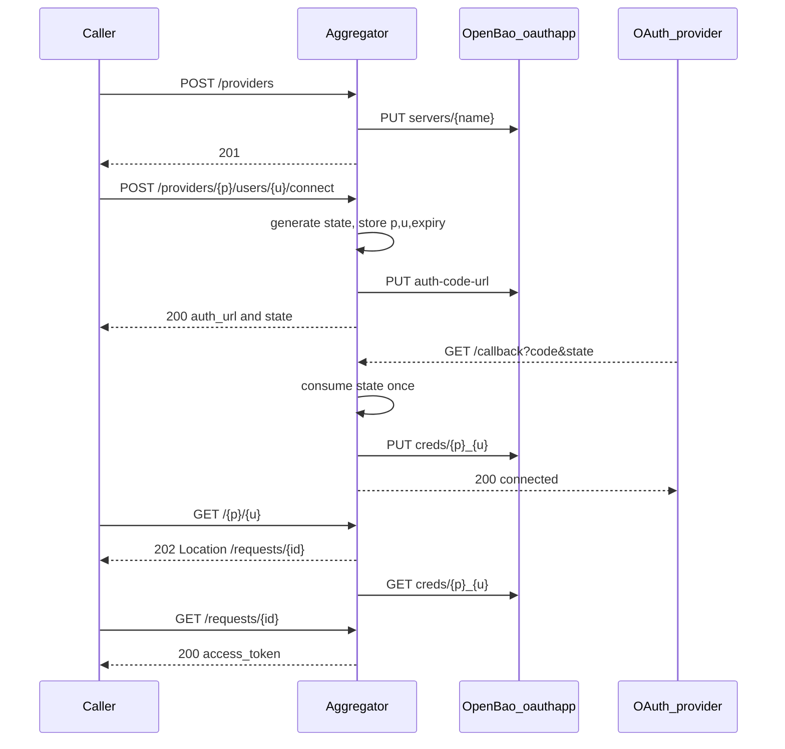

# Integration Aggregator implementation plan

## Current state

[`README.md`](C:\PROJECTS\integration-aggregator-takehome\README.md) is the only file in the repo. There is no application, Makefile, chart, or CI. The assignment README **takes precedence** over the prompt where they differ.

Critical README overrides of the prompt:

- Token retrieval **must return the access token** via `GET /requests/{id}` after the async worker finishes. That is the designated token endpoint. Tokens must not appear in logs, other HTTP responses, or Git.
- Delivery is not optional: **Helm chart, idempotent `make up`/`make down`, ghcr.io image+chart, GitHub Actions that runs minikube + smoke + perf**, and a one-page [`DESIGN.md`](DESIGN.md).
- Paths may be designed; behavior and data placement may not.

Language: **Python 3.11** (README allows Go or Python; the prompt specifies Python).

## Architecture

Data placement (mandatory):

- **OpenBao:** client secrets and all tokens (`servers/:name`, `creds/:name`).
- **Process memory only:** provider metadata (no secrets), pending OAuth `state`, async request records. Never written to disk. Document that this breaks with >1 replica.

No DB, Redis, Celery, or silent in-memory secret fallback if OpenBao is down.

## OpenBao oauthapp API (v3, verified)

Mount: `oauth2/`. HTTP prefix: `/v1/{mount}/`. Auth header: `X-Vault-Token`.

| Operation | Method | Path | Body / notes |
|---|---|---|---|
| Register provider | PUT | `servers/{name}` | `provider`, `client_id`, `client_secret`, optional `provider_options` (OIDC `issuer_url`) |
| Auth URL | **PUT** (not GET) | `auth-code-url` | `server`, `state`, `scopes`, `redirect_url` → `{data.url}` |
| Code exchange | PUT | `creds/{p}_{u}` | `server`, `code`, `redirect_url` — plugin talks to IdP; no tokens in write response |
| Token read | GET | `creds/{p}_{u}?minimum_seconds=10` | `{data.access_token,type,expire_time}` — plugin refreshes |

Do not use removed v2 paths (`config/auth-code-url`). Do not invent KV paths.

Client module: async httpx, timeouts, sanitized errors, never log token/secret/code. Injected fake in tests.

## API contract to implement

Exact assignment equivalents:

| Method | Path | Status | Body |
|---|---|---|---|
| `POST` | `/providers` | `201` | Request: `name`, `client_id`, `client_secret`, `provider` (`github`/`google`/`gitlab`/`oidc`), optional `scopes`, `provider_options`. Response: public metadata only (no secret). Duplicate → `409`. |
| `POST` | `/providers/{provider}/users/{user}/connect` | `200` | `{authorization_url, state}`. Unknown provider → `404`. |
| `GET` | `/callback` | `200` | `{status: connected, provider, user_id}`. Invalid/expired/replayed state, missing code, or IdP error → 4xx. |
| `GET` | `/{provider}/{user}` | `202` | `{request_id}` plus `Location: /requests/{id}`. Does **not** wait on OpenBao. |
| `GET` | `/requests/{id}` | `200` | `{request_id, status}` plus `access_token`/`token_type`/`expire_time` only when `succeeded`; sanitized `error` when `failed`. Unknown id → `404`. |
| `GET` | `/healthz` | `200` | liveness, no credentials |
| `GET` | `/readyz` | `200`/`503` | OpenBao health, no credentials |

Register specific routes **before** the catch-all `/{provider}/{user}`.

Statuses: `pending` → `in_progress` → `succeeded` | `failed`. Worker holds the token **only** inside the in-memory request record (required by the README sequence). Never log it. Optional TTL cleanup of completed records.

OAuth state: `secrets.token_urlsafe`, bound to `(provider, user_id)`, expiry, consume-once under `asyncio.Lock`.

## Application layout

Keep files well under ~300 lines:

- [`app/main.py`](app/main.py), [`app/config.py`](app/config.py)
- [`app/api/`](app/api/) — thin routers: `health`, `providers`, `oauth`, `tokens`, `requests`
- [`app/models/`](app/models/) — Pydantic request/response
- [`app/services/`](app/services/) — `provider_registry`, `oauth_state`, `oauth_service`, `token_service`, `request_manager`
- [`app/integrations/openbao_oauth.py`](app/integrations/openbao_oauth.py) — plugin adapter over a generic HTTP client
- [`app/core/errors.py`](app/core/errors.py), logging with secret redaction
- [`tests/unit/`](tests/unit/), [`tests/integration/`](tests/integration/) — FastAPI TestClient + fake OpenBao

Pinned deps: FastAPI, Uvicorn, Pydantic Settings, httpx, pytest, pytest-asyncio, ruff.

## Infra (README-mandatory)

**Helm chart** [`charts/aggregator/`](charts/aggregator/) (hand-written, not stock `helm create` leftovers): Deployment, Service, values for image/tag, `openbao.address`, replicas (default 1), resources, probes, securityContext, `envFrom` Secret for `OPENBAO_TOKEN` (secret created at deploy time, never committed).

**OpenBao in cluster** via official `openbao-helm`, **not** by mutating any existing broken injector:

- `injector.enabled: false` (avoids the known webhook field-ownership conflict; injector is unused).
- Prefer **standalone + inmem** over `server.dev.enabled` so `plugin_directory` works; document that this still skips persistence, unsealing, and TLS (assignment allows OpenBao “dev mode”).
- Init container downloads pinned **oauthapp v3** linux-amd64 binary into a shared emptyDir mounted as `plugin_directory`.
- Post-install Makefile steps (idempotent): register plugin by SHA-256, `secrets enable -path=oauth2 oauthapp`, write a **least-privilege policy** and child token for the aggregator.

In-cluster address (verify after install, default expectation): `http://openbao.openbao.svc.cluster.local:8200`.

**Makefile** (idempotent `make up` / `make down`):

1. `minikube start` if needed.
2. Helm install/upgrade OpenBao + plugin registration.
3. Build image, `minikube image load` (local) or pull from ghcr (CI after publish).
4. Create Kubernetes Secret from local env / CI secrets.
5. `helm upgrade --install` aggregator **from the chart**.
6. Deploy **mock-oauth2-server** (or Dex static passwords) as the programmatic OIDC provider for smoke/CI.
7. `make down` deletes releases/namespace/cluster pieces we created; second `make up` is a no-op upgrade.

**CI** [`.github/workflows/ci.yml`](.github/workflows/ci.yml) on every push:

1. Unit tests + Ruff (no live OpenBao).
2. Build/push image and Helm chart to `ghcr.io/<owner>/...` with `GITHUB_TOKEN`.
3. `setup-minikube` on `ubuntu-latest`, `make up`.
4. Smoke: register mock OIDC via `POST /providers`, complete consent programmatically, callback, `GET /{p}/{u}` → 202, poll `/requests/{id}` for token. Also register a second provider type (`github` metadata path can be skipped if no secret in CI; local OIDC counts as the second provider per README hint — GitHub remains the real-provider path documented in a committed curl transcript).
5. k6 (or hey) load test of token retrieval; upload p50/p95/throughput report as an artifact.

**Perf:** [`perf/token_retrieval.js`](perf/token_retrieval.js) + [`perf/REPORT.md`](perf/REPORT.md) filled from a real run (honest numbers, two or three concurrencies).

**Docker:** Python 3.11 slim, non-root, no secrets copied, healthcheck, [`.dockerignore`](.dockerignore).

**Docs:** keep original assignment README; add implementation sections **or** a separate [`docs/USAGE.md`](docs/USAGE.md) plus required [`DESIGN.md`](DESIGN.md) (architecture, data placement, single-replica failure mode + Redis/queue fix, OpenBao non-prod caveats, GitHub + local OIDC as the two providers). [`.env.example`](.env.example) placeholders only. [`.gitignore`](.gitignore) for env, tokens, unseal keys.

## Tests (must exist before calling the work done)

Unit: provider validation/duplicates, state generate/expire/mismatch/replay, auth URL construction via fake plugin, callback success and provider errors, async 202 + Location, status transitions, OpenBao timeout/error sanitization, **no token leakage** in non-token responses and log captures.

Integration: TestClient + injected fake OpenBao covering the three flows end-to-end. No real IdP, no k8s, no network.

Do not weaken production code to make tests pass.

## Implementation order

1. Scaffold config, models, error handling, fake OpenBao, health.
2. Provider registry + `POST /providers` + tests.
3. Real OpenBao adapter using the table above + tests.
4. Connect + callback (state store, plugin auth-code-url + creds write) + tests.
5. Async token GET + request status (token only on success) + tests.
6. Docker, Helm, Makefile, mock OIDC, smoke script.
7. CI, perf, DESIGN.md, usage docs, GitHub curl transcript instructions.
8. Full pytest, ruff, docker build, `helm template` lint.

## Verification (after implementation)

- `pytest` and `ruff check` locally.
- `docker build` and container start with dummy env (readiness may fail without OpenBao — document that).
- `helm template` for chart validity.
- CI on the fork is the assignment’s evaluation surface; local `make up` needs minikube/Docker on the machine and will be exercised in CI.

## Requirement → implementation map

- Register provider → `app/api/providers.py` + `openbao_oauth.write_server` + unit/integration tests
- Connect + state → `oauth_state.py` + `PUT auth-code-url`
- Callback → consume state + `PUT creds/{p}_{u}`
- Async token → `request_manager` + `GET creds/{p}_{u}` + `202`/`Location`
- Status/token poll → `GET /requests/{id}`
- Makefile/Helm/CI/perf/DESIGN.md/ghcr → delivery files listed above
- No secrets in git/logs → `.gitignore`, redacting logger, tests
